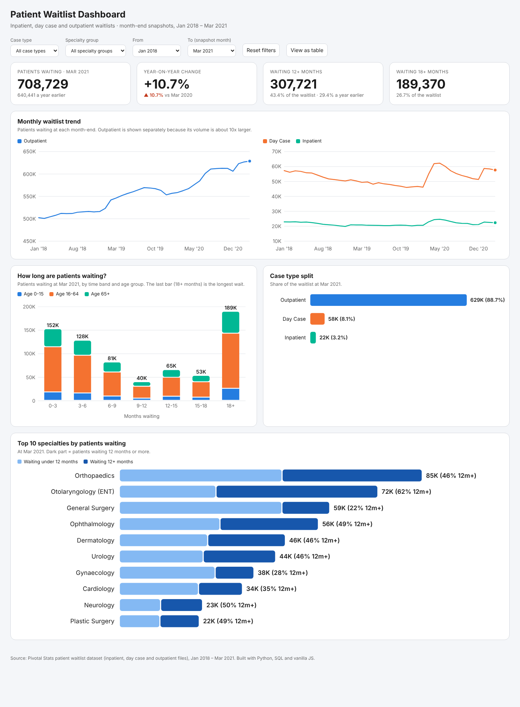

# Patient Waitlist Analysis

An end-to-end data analysis project: raw hospital waitlist files, cleaned in **Python**, queried with **SQL**, and presented in an **interactive dashboard** with recommendations.



**Live dashboard:** open `dashboard/index.html` in any browser (no software or internet needed).

## Problem statement

Hospital waitlists keep growing. In this data the total waitlist rose from about 640K to 709K patients in one year. Long waits delay care, hurt patient outcomes and strain hospital capacity, yet management has no single view of who is waiting, for which specialty, for how long, and whether it is getting better or worse.

**Objective:** use Jan 2018 to Mar 2021 inpatient, day case and outpatient waitlist data to find where the biggest problems are, and recommend where to act first.

**Business questions**
1. How many patients are waiting now, and how does that compare with last year?
2. Which specialties have the largest waitlists and the longest waits?
3. What share of patients has waited more than 12 or 18 months?
4. How do waits differ by age group and case type?
5. Is the waitlist trending up or down?

## Key findings

| # | Finding |
|---|---|
| 1 | **708,729 patients** were waiting in Mar 2021, up **10.7%** from 640,441 a year earlier and up **21.6%** since Jan 2018. |
| 2 | **43.4% (307,721)** had waited 12+ months, up from **29.4%** a year earlier. **189,370 (26.7%)** had waited 18+ months, the largest single time band. |
| 3 | **Outpatient is 88.7%** of the list and has the highest long-wait share (**45.1%** waiting 12+ months, vs 37.1% inpatient and 27.0% day case). |
| 4 | The **top 3 specialties** (Orthopaedics, ENT, General Surgery) hold **30.5%** of all waiting patients. |
| 5 | **ENT has the worst backlog: 62.5%** of its 72K patients have waited 12+ months. Ophthalmology (49%), Dermatology (46%) and Orthopaedics (46%) follow. General Surgery is the best of the large specialties at 22%. |
| 6 | Adults aged **16-64 make up 61.8%** of the 12+ month waiters, 65+ are 24.8% and children are 13.3%. |
| 7 | Day case and inpatient waitlists **jumped in spring 2020** and then partly recovered, while the outpatient list kept climbing. |

## Recommendations

1. **Target long waits, not just volume.** Set a 12-month waiting-time target and track the 12+ and 18+ month share monthly.
2. **Prioritise ENT, Ophthalmology, Dermatology and Orthopaedics** for extra clinic and theatre capacity, because they combine large lists with long waits.
3. **Focus on outpatient.** It is almost 9 in 10 patients, so a small efficiency gain (triage, virtual clinics, discharge of routine follow-ups) has the biggest effect.
4. **Plan for age mix.** Most long waiters are working-age adults, so evening and weekend lists would reach them.
5. **Use the dashboard monthly** to watch the year-on-year change and the long-wait share by specialty.

## Project workflow

| Step | What I did | File |
|---|---|---|
| 1. Clean | Combined 8 yearly files, aligned column names, trimmed text, fixed `18 Months +`, removed 177 unusable rows, added Case_Type for outpatient, joined the specialty groups | `src/clean_data.py` |
| 2. Explore | Headline numbers, case type, specialty and age analysis, charts | `src/eda.py` |
| 3. Query | 10 SQL queries including window functions (`LAG`, `RANK`) and year-on-year logic | `sql/waitlist_queries.sql` |
| 4. Visualise | Interactive dashboard with filters, KPIs, hover tooltips, dark mode and a table view | `src/build_dashboard.py` -> `dashboard/index.html` |
| 5. Recommend | Findings and actions above | this README |

## Data

| File | Rows | Notes |
|---|---|---|
| `data/raw/IN_WL 2018-2021.csv` | ~182K | Inpatient and day case |
| `data/raw/Op_WL 2018-2021.csv` | ~271K | Outpatient (no Case_Type column) |
| `data/raw/Mapping_Specialty.csv` | 78 | Specialty -> specialty group |
| `data/clean/waitlist_clean.csv` | 452,942 | Cleaned combined table |

**Columns:** `Archive_Date` (month-end snapshot), `Specialty_HIPE` (specialty code), `Specialty`, `Case_Type`, `Adult_Child`, `Age_Profile` (0-15, 16-64, 65+), `Time_Bands` (0-3 months up to 18+ months), `Total` (number of patients in that group).

**Important:** each row is a *count of patients*, and each date is a snapshot. To get the waitlist size, add up `Total` for **one** date, never across dates.

## How to run

```bash
pip install -r requirements.txt
python src/clean_data.py        # builds data/clean/waitlist_clean.csv
python src/eda.py               # prints findings, saves charts to images/
python src/build_dashboard.py   # builds dashboard/index.html
```

## Tools

Python (pandas, matplotlib), SQL (SQLite-compatible), HTML/CSS/JavaScript (SVG charts), Git/GitHub.

## Credits

Dataset from the [Pivotal Stats end-to-end Power BI dashboard project](https://pivotalstats.com/end-end-power-bi-dashboard-development/). Built with AI assistance (Claude); the analysis, SQL and dashboard were reviewed and are understood by me.
